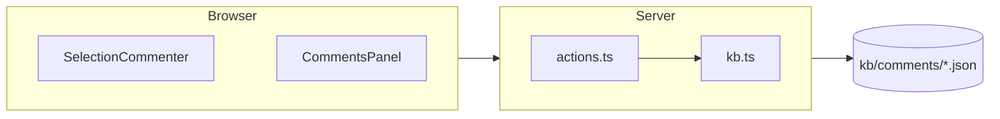

# fumano (DocKB)

**DocKB** gives you clean public documentation (`docs/`) powered by Fumadocs, plus an optional `kb/` layer that adds:

- Persistent, flat, timestamped JSON comments in `kb/comments/`
- Internal developer knowledge in `kb/dev/`
- Automatic rich mode (commenting UI) when `kb/` exists

No sync step. Designed from the ground up to be usable by agents (including running persistent loops that watch `kb/comments/` for new feedback).

## When to Use This Skill

- You need to add high-quality, agent-friendly documentation to a project.
- You want comments/questions to live as first-class git artifacts that both humans and LLMs can create and resolve.
- You want the agent to run persistent loops that regularly discover and act on new comments in `kb/comments/`.
- You are starting a docs site or upgrading an existing one to support agentic workflows.

## Core Folder Contract

```
your-project/
├── docs/                 # Public docs (Fumadocs MDX source). Edit these.
├── kb/
│   ├── dev/              # Internal only. Agents read here for privileged context.
│   └── comments/         # Flat *.json files. Never edit docs/ to "sync" comments.
├── app/                  # (if using the full template) Next.js + Fumadocs routes
└── ...
```

**Rule:** User-facing docs live **only** in `docs/`. Never create `kb/users/`.

**Location rule (very important for agents):** `kb/` goes at the **project root**, next to `docs/`. Creating `docs/kb/` is incorrect.

**Embedded sites:** if the docs site lives inside a larger repo (e.g. `<repo>/docs/` is the Next.js project), "project root" means the **site** root — the directory `process.cwd()` points at when the Next server runs (`hasKB()` checks `cwd/kb`). There, `kb/` sits next to `app/` and the content directory, e.g. `<repo>/docs/kb/`. Moving it to the outer repo root silently disables rich mode.

## Authoring `kb/dev` — always show structure visually

**Rule: in `kb/dev`, never describe architecture or layout in prose alone.**
Anything structural gets a **directory tree** and/or a **mermaid diagram**.
Prose describing a call graph or a folder layout is the thing this KB exists to
replace — an agent (or a human) reading `kb/dev` should be able to see the shape
of the system without reconstructing it sentence by sentence.

Apply it to:

- **Project / folder structure** → a fenced tree block.
- **Architecture, module boundaries, data flow, request lifecycle, state
  machines, queues** → a mermaid diagram.
- **Anything with more than ~3 related parts** → diagram it. If you catch
  yourself writing "X calls Y, which passes to Z", stop and draw it.

Structure goes in a fenced code block:

````markdown
```
docs-site/
├── app/
│   ├── dev/[[...slug]]/   # kb/dev renderer (force-dynamic)
│   └── api/search/        # combined docs + kb/dev index
├── lib/
│   ├── kb.ts              # hasKB(), readComments(), locateQuote()
│   └── layout.shared.ts   # siteMeta — the file you own
└── kb/
    ├── dev/               # this KB
    └── comments/          # flat JSON
```
````

Architecture goes in mermaid (rendered by `remarkMdxMermaid` + the theme-aware
`Mermaid` component — see Field Notes):

````markdown

````

**Mermaid layout (learned the hard way):** connect **subgraph to subgraph**, not
node-to-node across subgraphs — node-level fan-outs collapse the layout into one
tall unreadable column. Use `direction LR` inside subgraphs and invisible `~~~`
links to order nodes within a module.

## Defaults for every DocKB site

Two things are on by default and should stay on. Both exist so that deep
documentation stays navigable — for humans in the sidebar, for agents through
the raw markdown.

1. **Nested, folding sidebar** — never a flat list of pages (below).
2. **Page actions: Copy Markdown + Open in AI** — on every docs and kb/dev page
   (below).
3. **A color scheme** — a Fumadocs preset plus semantic status colors, never the
   monochrome default (below).
4. **Mermaid on both renderers** — diagrams work in `docs/` *and* `kb/dev`
   (below).
5. **Notebook layout** — full-width top nav, tab switcher above the sidebar
   (below).

### Notebook layout (default)

Both roots use `DocsLayout` from **`fumadocs-ui/layouts/notebook`** (not
`fumadocs-ui/layouts/docs`), with `nav={{ ...base.nav, mode: 'top' }}` and
`tabMode="sidebar"`.

The two content roots are the **tabs** (`lib/tabs.ts`): *Documentation* → `/docs`,
and — only when `hasKB()` — *Dev KB* → `/dev`. That tab switcher is what moves a
reader between public docs and the internal KB, so the KB page tree must **not**
carry its own "back to docs" link, and the docs layout must not fake one with a
nav `links` entry. In plain mode there is a single tab and the switcher collapses
to a title.

### Folding sidebar — put files in folders (default)

Both sidebars render **collapsible folders**, so use real directories instead of
long flat lists. The folder containing the current page auto-expands; the rest
stay folded. Structure the content this way from the start — retrofitting folders
later changes every URL.

- **`kb/dev`** — folders come straight from the directory layout. `kb/dev/architecture/data-flow.md`
  becomes a collapsible **Architecture** folder containing **Data flow**. A
  `README.md` inside a folder becomes that folder's index page (clicking the
  folder name opens it). Page names come from the frontmatter `title:` when
  present, otherwise the humanized filename — so give each note a `title:`.
- **`docs/`** — nest content in a subdirectory with its own `meta.json`
  (`{"title": "Guides", "pages": ["deep-dive"]}`) and add the folder to the
  parent `meta.json` `pages` array.

Nesting is what makes the folding useful: a flat `kb/dev` with fifteen notes is
a wall of links. Group them (`architecture/`, `decisions/`, `runbooks/`) as soon
as there is more than a handful. The template ships nested (`docs/guides/`,
`docs/reference/`) — keep that shape when you add content.

### Diagrams — mermaid on both renderers (default)

There are **two** MDX pipelines, and mermaid has to be wired into each:

- **`docs/`** — build-time collection. `source.config.ts` passes `remarkMdxMermaid`
  through `mdxOptions.remarkPlugins`, and the docs page puts `Mermaid` in its MDX
  components map.
- **`kb/dev`** — request-time compiler in `app/dev/[[...slug]]/page.tsx`, same
  plugin + component.

The template ships both. If you are *injecting* DocKB into an existing project and
wire only the kb renderer, ```` ```mermaid ```` fences on docs pages degrade to a
plain code block — **silently**, with no error. Same failure if the component is
missing from the components map.

**Width discipline (learned the hard way).** Mermaid shrinks a diagram to fit the
content column. A row of five nodes scales down until the labels are unreadable,
which defeats the diagram. So:

- Keep **3–4 nodes per row**, max.
- Stack with `flowchart TB` on the outside and `direction LR` inside subgraphs.
  A long `flowchart LR` chain is the thing that always comes out too small.
- Do **not** "fix" this with `flowchart: { useMaxWidth: false }` — the diagram then
  renders at natural size and overflows the column, which clips it. Narrow rows are
  the fix; the scroll wrapper is only a backstop.

**Figures that cannot drift.** For anything the project itself computes (a geometry,
a schema, a state machine), generate the SVG *from the project's own code* in a small
script (`docs/scripts/gen_*.py`) rather than drawing it by hand — then the figure
cannot fall out of sync with the model it illustrates, and the docs can say so. Use a
transparent background and mid-tone ink (`#8a8fa0`-ish) so it reads on both themes,
and keep it deterministic so regeneration doesn't churn the git diff.

### Page actions — "Copy Markdown" and "Open in AI" (default)

Every page carries a **Copy Markdown** button and an **Open** popover (View as
Markdown / Open in GitHub / ChatGPT / Claude / Cursor). Fumadocs ≥16 ships both;
they only need a URL that serves the page's raw markdown.

```
app/
├── llms.mdx/[[...slug]]/route.ts   # raw source, path mirrors the page:
│                                   #   /docs/guides/x  -> /llms.mdx/docs/guides/x
│                                   #   /dev/arch/y.md  -> /llms.mdx/dev/arch/y.md
└── llms.txt/route.ts               # llms(source).index() — public docs only
components/PageActions.tsx          # MarkdownCopyButton + ViewOptionsPopover
```

- Import the buttons from **`fumadocs-ui/layouts/docs/page`** — `fumadocs-ui/page`
  does not re-export them.
- Render `<PageActions markdownUrl={...} githubUrl={...} />` between
  `DocsDescription` and `DocsBody` in **both** `app/docs/[[...slug]]/page.tsx`
  and `app/dev/[[...slug]]/page.tsx`.
- `githubUrl` comes from `siteMeta.github` in `lib/layout.shared.ts` (set it, or
  `null` to drop the GitHub entry). **kb/dev pages get no GitHub link** — that
  repo is gitignored and often private.
- `/llms.mdx/**` must be `force-dynamic`: kb/dev is read from disk at request
  time. `/llms.txt` indexes the public docs only — never the KB.

### Color — never ship the monochrome default

A DocKB site is **not** black-and-white. Two layers, both in `app/globals.css`:

1. **Preset** — one import line recolors the whole site. Fumadocs ships
   `neutral, black, ocean, dusk, purple, emerald, ruby, catppuccin, vitepress,
   aspen, solar, shadcn`. The template defaults to **`ocean`**; pick another to
   fit the project, but don't leave it on `neutral`/`black`.

   ```css
   @import 'fumadocs-ui/css/ocean.css';   /* <- swap this line */
   @import 'fumadocs-ui/css/preset.css';  /* must come after */
   ```

2. **Semantic colors** — a small `@theme` block for things that carry *meaning*,
   with a `.dark` override for each (light-mode colors are unreadable on dark):

   ```css
   @theme {
     --color-dockb-open: hsl(32, 90%, 38%);       /* open comment  */
     --color-dockb-resolved: hsl(152, 55%, 30%);  /* resolved      */
     --color-dockb-dev: hsl(265, 60%, 50%);       /* internal KB   */
   }
   .dark { --color-dockb-open: hsl(38, 95%, 68%); /* … */ }
   ```

   Each has a low-alpha `-bg` companion, so badges are `bg-dockb-open-bg
   text-dockb-open` rather than another shade of grey. Used by the comment
   items, the comment queue, and the `kb/dev` marker.

Everything else stays on Fumadocs' `fd-*` tokens (`bg-fd-card`,
`text-fd-muted-foreground`, …) so a preset swap recolors it for free. Never
hardcode a hex in a component.

## Shared Runtime (preferred — one system-wide install, zero node_modules per project)

One installed copy of this template serves any number of projects, so a project
needs **only content**: `docs/`, optionally `kb/`, and a small `dockb.json`.
No `package.json`, no `node_modules`, no `app/` in the project.

```
~/apps/dockb-runtime/     # ONE clone of this template, npm-installed once
project/
├── docs/                 # content only
├── kb/                   # optional, gitignored, rich mode
└── dockb.json            # site identity (see below)
```

**Serve a project** (launcher symlinked at `~/.local/bin/dockb` →
`<runtime>/bin/dockb`):

```bash
cd myproject          # the dir containing docs/
dockb                 # port 3000; `dockb 3777` for another port
```

The launcher exports `DOCKB_ROOT=$PWD` and starts `next dev` inside the runtime.
Everything root-relative (`hasKB()`, docs collection, comment actions, llms
routes) resolves against `DOCKB_ROOT`, falling back to `process.cwd()` so an
embedded install keeps working unchanged. Each project gets its own cache dir
(`<runtime>/.next-projects/<name>-<hash>`), so switching projects can't serve a
stale `.next`. Two projects at once = two ports, two `dockb` invocations.

**`dockb.json`** — site identity, read from the project root at server start
(missing file/fields → DocKB defaults; restart the server after editing):

```json
{
  "name": "myproj",
  "title": "myproj — what it is",
  "description": "One-liner for meta tags and llms.txt.",
  "github": { "url": "https://github.com/me/myproj", "branch": "main" }
}
```

Set `"github": null` to drop the GitHub page action and nav link.

**Setting up the runtime once:**

```bash
cp -r <this skill dir> ~/apps/dockb-runtime   # or git clone the template
cd ~/apps/dockb-runtime && npm install
ln -s ~/apps/dockb-runtime/bin/dockb ~/.local/bin/dockb
```

**Limits.** The runtime serves the *vanilla* template: sites with customized
app code (extra components, staged content dirs, `DOCS_CONTENT_DIR` tricks)
still need their own embedded install. Color preset is per-runtime (static CSS
import), not per-project. `next build`/static export from the shared runtime is
untested — it's a dev-server workflow; embed for production builds.

## Quick Start — Embedded (per-project install)

**Use when the shared runtime's limits bite (custom app code, production
builds); otherwise prefer the shared runtime above.**

```bash
# Use this repo as a GitHub template, or:
git clone <this-repo> docs-site
cd docs-site
npm install
npm run dev
```

Then:

**From the root of your project** (the directory containing `docs/`, **not** inside `docs/`):

```bash
# Enable rich mode — kb/ must live at project root as sibling to docs/ (never docs/kb)
echo "kb/" >> .gitignore
mkdir -p kb/dev kb/comments
cd kb
git init
git add .
git commit -m "init kb repo (dev notes + comments)"
cd ..
git add .gitignore
git commit -m "kb/ is now its own git repo"
```

**Verify correct location:**
```bash
ls -d kb docs 2>/dev/null && [ -d kb ] && [ ! -d docs/kb ] && echo "✓ kb/ is correctly at project root" || echo "✗ ERROR: kb/ should be next to docs/, not inside it"
```

## Minimal Injection (Add to Existing Project)

If the project already has docs or you only want the commenting layer:

**Important:** `kb/` must live at the **root of the project**, as a sibling to your `docs/` folder (never inside `docs/kb`).

1. From the **root** of your project (the directory that contains your `docs/` folder), ensure you have a `docs/` folder with your markdown/mdx content.
2. Copy these pieces from the fumano template (into your project root):
   - `lib/kb.ts` (hasKB detection + id/sha helpers)
   - `lib/types.ts` + `lib/actions.ts` (the Server Actions)
   - `components/comments/`
   - `components/PageActions.tsx` + `app/llms.mdx/[[...slug]]/route.ts` +
     `app/llms.txt/route.ts` (the default page actions)
3. Wire the `CommentsPanel` and `PageActions` into your doc pages (`CommentsPanel`
   only when `hasKB()`; `PageActions` always).
4. Create the `kb/` directory at the project root (see the "kb/ as its own git repository" section below).

See `docs/guides/getting-started.mdx` and `docs/reference/architecture.mdx` in the template for details.

## Working with Comments (Agent Recipes)

### Create a comment

Quote is optional (you can comment on the whole page or section without a specific excerpt).

```bash
ID=$(date -u +%Y-%m-%dT%H-%M-%SZ | tr : - | cut -c1-20)_$(openssl rand -hex 3)
cat > "kb/comments/${ID}.json" << 'EOC'
{
  "id": "<ID>",
  "timestamp": "<ISO>",
  "file": "docs/path/to/page.mdx",
  "repo": "main",
  "sha": "<short-sha-of-file>",
  "quote": "exact text you are commenting on" | null,
  "lineStart": 12,
  "lineEnd": 14,
  "comment": "Clear, actionable note or question.",
  "author": "grok-4",
  "status": "open",
  "tags": ["suggestion"],
  "resolvedAt": null,
  "resolvedBy": null
}
EOC
```

### Find open comments

```bash
grep -l '"status": "open"' kb/comments/*.json
```

### Resolve

Edit the JSON file in place and set `status`, `resolvedAt`, `resolvedBy`. Commit.

## Agent Comment Monitoring Loop (highly recommended)

For active, ongoing collaboration, explicitly instruct the agent (or run the agent in a mode) to start a **periodic loop** that regularly scans for new comments.

Example loop the agent can run (adapt to the environment; run from project root):

```bash
while true; do
  echo "=== [$(date)] Scanning for open comments ==="

  # Find all open comments (flat files make this trivial)
  open_files=$(grep -l '"status": "open"' kb/comments/*.json 2>/dev/null || true)

  for c in $open_files; do
    echo "→ Processing $c"
    # Read the comment
    cat "$c" | jq .

    # Read the target document
    target_file=$(jq -r '.file' "$c")
    echo "   Target: $target_file"
    # read_file "$target_file"   (or cat if outside agent tools)

    # Decide action:
    # - Edit the source in docs/ to address the issue
    # - Or reply with a follow-up comment JSON
    # - Then resolve:
    #   jq '.status = "resolved" | .resolvedAt = "'$(date -Iseconds)'" | .resolvedBy = "agent"' "$c" > "$c.tmp" && mv "$c.tmp" "$c"
  done

  # Commit any resolutions/changes inside the kb/ repo
  (cd kb && git add -A && git commit -m "agent loop: processed comments $(date +%H:%M)" || true)

  # Wait before next scan (adjust interval)
  sleep 120   # 2 minutes, or use external scheduler / cron / agent hook
done
```

**Why this is powerful**
- Agents become persistent documentation maintainers.
- Humans (or other agents) leave comments in `kb/comments/`.
- The loop discovers them via simple `grep`, reads the referenced `docs/...` file, acts, and resolves.
- Everything stays in git (inside the separate `kb/` repo).

**Tips for the agent**
- Run the loop at the start of a long session or as a background habit ("every 10 turns, check for comments").
- Prioritize recent comments (sort by timestamp or filename).
- When resolving, always update `resolvedAt` / `resolvedBy` and commit inside `kb/`.
- Use `jq` for safe JSON edits.
- If the project has a scheduler (or you can spawn background tasks), prefer that over a tight `while sleep` loop.

Add this behavior to your system prompt / agent instructions when using the fumano skill for long-running documentation work.

## Rich vs Plain Mode

- `kb/` present → rich mode (comment UI appears on docs pages, internal knowledge available).
- `kb/` absent → plain/clean mode. The site stays simple.

Detection is pure `fs.existsSync('kb')` at runtime and in server actions.

## kb/ as its own git repository

**Critical:** `kb/` always lives at the **root of your project** as a sibling to `docs/`. Never create it as `docs/kb/`.

When enabling rich mode, **initialize `kb/` as a separate git repo** (exactly like the `notes/` pattern in the project_setup skill).

Recommended commands (run from project root):

```bash
echo "kb/" >> .gitignore          # main repo never tracks kb/ contents
mkdir -p kb/dev kb/comments
cd kb
git init
# (optional) echo '*.json diff=json' > .gitattributes   # nice for comments
git add .
git commit -m "init kb repo (internal dev + comments)"
cd ..
git add .gitignore
git commit -m "kb/ is its own git repo"
```

**Quick location check (run from project root):**
```bash
[ -d kb ] && [ ! -d docs/kb ] && echo "✓ kb/ is at project root (correct)" || echo "✗ kb/ is in the wrong place"
```

Ongoing workflow:
- Make changes inside `kb/` (new comments, updates to dev notes).
- Commit them *inside the kb repo*: `git -C kb add -A && git -C kb commit -m "..."`.
- The main project only ever commits the fact that `kb/` is ignored.

**Strongly recommended:** Start (and maintain) a comment-monitoring loop (see "Agent Comment Monitoring Loop" section above) so the agent regularly discovers and acts on new feedback left by humans or other agents.

Verification an agent should run after setup:
```bash
[ -d kb/.git ] && echo "kb/ is a separate git repo ✓" || echo "Missing kb/.git — run git init inside kb/"
git check-ignore -v kb/ || echo "kb/ should be ignored by main repo"
```

Why do this?
- Independent history for potentially large or private internal material.
- Easy to clone the main docs without pulling kb/ (or to share kb/ selectively).
- Matches established patterns in this skills collection.

## Field Notes (learnings from production use)

Hard-won specifics from running DocKB on a real project (b3_af), with an
agent draining the comment queue for a full working session:

**Rendering the KB**
- Render `kb/dev` at **request time** with `@fumadocs/mdx-remote`
  (`createCompiler({format: 'md'})`) inside `DocsLayout`/`DocsPage` — never
  as a build-time `defineDocs` collection: `kb/` is gitignored, so a
  build-time collection breaks `next build` for plain-mode adopters and goes
  stale in rich mode. Mark the `/dev` routes `dynamic = 'force-dynamic'`.
- Mermaid in kb articles: `remarkMdxMermaid` (fumadocs-core) + a theme-aware
  client component (`mermaid.render`, theme from the `dark` html class).
- Mermaid **layout**: for module/architecture diagrams, connect
  **subgraphs to subgraphs**, not nodes across subgraphs — node-level
  fan-outs collapse the layout into one tall column. Use `direction LR`
  inside subgraphs and invisible `~~~` links to order intra-module nodes.

**Titles and links (the two renderers behave differently)**
- **Body `# H1`: docs pages must not have one, kb/dev pages must.** The docs page
  renders `<DocsTitle>{page.data.title}</DocsTitle>`, so a body `# ` is a *second*
  H1 on the page. The kb/dev renderer prints no title of its own, so a kb note
  without a body H1 opens with no heading at all.
- **The docs sidebar label *is* the frontmatter `title`** — there is no separate
  sidebar name. A long article title ("Foo: Surrogate-Driven Inverse Sizing of…")
  becomes a long, wrapping sidebar entry. Give the page a short `title` and put the
  long sentence in `description` (the `%s | site` template keeps the tab sensible).
- **kb/dev `title:` must be unquoted.** `frontmatterTitle()` strips quotes with a
  naive regex, so a YAML-quoted title (which you need the moment the title itself
  starts with a quote) leaks literal `\"` into the sidebar.
- **`[[wikilinks]]` are not supported** by the kb renderer — they render as literal
  text. Cross-link kb notes with real links: `[Title](/dev/architecture/note.md)`
  (the `.md` extension is part of the route).
- **`/dev` 404s unless `kb/dev/README.md` exists** — the route resolves to
  `README.md` by default. A KB with only subfolders has a dead root.

**Comments in practice**
- The monitoring loop works best **event-driven**: a background file watcher
  that emits only when the set of open comments *grows* (so your own
  resolutions don't wake you), with a slow fallback heartbeat — not a tight
  `sleep` loop.
- Comments are not just docs edits: expect **behavior-change requests**
  (new options, API changes). Implement TDD-first, then resolve. Always
  append a `[resolution: ...]` note into the comment JSON so the queue is
  self-explaining.
- **Anchor quotes to source lines server-side** in `createComment`: strip
  markdown decorations and normalize whitespace on both sides (the quote is
  rendered text, the source is markdown), then map through a char→line
  stream. Selections spanning wrapped lines then resolve to exact ranges.
- Scope discipline: `kb/dev` holds **project** knowledge only. The DocKB
  workflow itself (schema, loop, recipes) is *this skill's* documentation —
  project KBs should link to it, not restate it.

**Assets & environment**
- Terminal/CLI output belongs in the docs as **verbatim text between
  markers**, regenerated by a script (`{/* cli-help:start */}` … end) — not
  as SVG screenshots: ANSI truecolor is not theme-safe and text can't drift.
- Generated figures: transparent background + mid-tone foreground
  (`#8a8fa0`-ish) render on both themes; pin determinism (no timestamps,
  fixed hash salts) so regeneration doesn't churn git diffs.
- Gotcha: running `next build` in a project whose **dev server is running**
  poisons its `.next` cache — pages 404 or serve stale code until you
  `rm -rf .next` and restart. Symptoms look exactly like "my change didn't
  work". Browser tabs loaded during the poisoned window keep dead LAYOUT
  handlers (theme toggle / search no-op on click) even after the server
  recovers, while page-level components still work — looks browser-specific
  but isn't; hard-refresh the tab.
- Write docs and resolution notes in plain, factual language — project
  owners flag dramatic phrasing.
- Gotcha: opening the dev server on a **LAN address** instead of localhost
  (e.g. `http://192.168.x.x:3000` from another machine) makes Next 403 every
  `/_next/*` dev resource, so the client bundle never hydrates. The page still
  server-renders and looks completely normal — but every client component is
  dead, so **the comment panel and selection commenting silently do nothing**
  while the panel itself is visibly present in the HTML. Symptom reads as
  "comments are broken"; nothing is broken. `next.config.ts` ships
  `allowedDevOrigins` for the private ranges to prevent this (override with
  `DOCKB_DEV_ORIGINS`). Same family as the poisoned-`.next` gotcha above: if
  the UI renders but doesn't *respond*, suspect hydration, not the code.
- Keep project identity (site name, title, description, nav links) in
  `lib/layout.shared.ts` — it exports `siteMeta`, and `app/layout.tsx` reads
  from it. Editing `app/layout.tsx` per project forks a file that should stay
  refreshable.

## Self-Documentation

The template contains excellent living docs:

- `/docs/reference/architecture`
- `/docs/reference/commenting` (full schema)
- `/docs/guides/agent-guide`
- `/docs/guides/getting-started`

When the fumano skill is active, prefer reading the rendered versions or the source `.mdx` files directly.

## Verification After Changes

After editing docs or leaving comments:

- `npm run build` must succeed — **but not while a dev server is running on this
  site**: that poisons its `.next` cache (see Field Notes). If one is up, verify
  against it instead of building: `curl -o /dev/null -w '%{http_code}'` every route
  you touched.
- **Screenshot any page with a diagram.** A 200 proves nothing here: a mermaid
  fence with a syntax error, or an unwired renderer, degrades to a plain code block,
  and a too-wide diagram renders with unreadable labels. Both look fine in the HTML.
  `chromium --headless=new --virtual-time-budget=15000 --screenshot=<path> <url>`,
  then look at the image. (Gotcha: a snap-packaged chromium **cannot write into
  `/tmp`** — Permission denied. Write the screenshot under `$HOME`.)
- Check **both themes** for figures and diagrams — `--blink-settings=preferredColorScheme=1`
  renders the light one.
- Sidebar shows folders, not a flat list (`docs/*/meta.json`, `kb/dev/*/`)
- Page actions work: `curl -sI localhost:3000/llms.mdx/docs/<slug>` returns
  `200 text/markdown`, and the page HTML contains "Copy Markdown"
- In rich mode the new comments appear on the page
- In plain mode (temporarily rename `kb/`) there are no comment UI elements and no errors
- `kb/` changes are committed inside the kb/ repo (`git -C kb log --oneline`), not the main repo
- **Location check:** `kb/` exists at project root and there is no `docs/kb/`

Commit documentation changes to the main repo. Commit comments/dev notes inside `kb/`.

This skill + the files in this directory give you a complete, git-native, agent-first documentation system.
