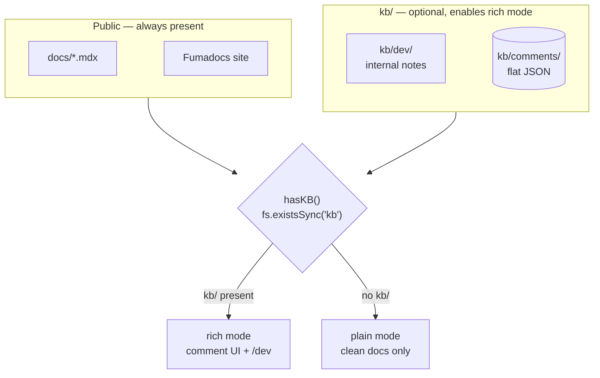

DocKB deliberately keeps two layers separate.



## Folders

| Folder         | Purpose                              | Visible in plain mode? | Git handling (per skill)                  |
|----------------|--------------------------------------|------------------------|-------------------------------------------|
| `docs/`        | Public, user-facing documentation    | Yes                    | Committed to main repo                    |
| `kb/dev/`      | Internal developer knowledge         | No                     | Its own git repo (ignored from main)      |
| `kb/comments/` | All comments as flat JSON files      | No (UI only in rich)   | Its own git repo (ignored from main)      |

There is **no** `kb/users/`.

`kb/` must be created at the **project root** as a direct sibling of `docs/`. Agents must never create it inside `docs/kb`.

## No Sync Guarantee

- Nothing in `kb/` is ever copied or transformed into `docs/`.
- Comments reference `file` paths inside `docs/` by string only.
- Agents and humans are expected to keep the two in sync manually when appropriate (by editing source or resolving comments).

In rich mode you also get a native tree viewer at [/dev](/dev) powered by Fumadocs' `<Files>` component from `fumadocs-ui/components/files`.

Example usage in a React page or MDX (after registering):

```tsx
import { Files, Folder, File } from 'fumadocs-ui/components/files';

<Files>
  <Folder name="kb" defaultOpen>
    <Folder name="dev">...</Folder>
    <Folder name="comments">...</Folder>
  </Folder>
</Files>
```

## Comment Storage

Every comment is an individual file:

```
kb/comments/2026-07-11T09-15-23Z_a3f2k9.json
```

Flat namespace = trivial for agents to:
- `ls kb/comments`
- `grep -l '"status": "open"' kb/comments/*.json`
- `cat kb/comments/....json | jq`

The exact schema is documented in [Commenting](/docs/reference/commenting).

## Mode Detection

```ts
// lib/kb.ts
export function hasKB() {
  return fs.existsSync(path.join(process.cwd(), 'kb'));
}
```

Used at runtime in Server Components and Server Actions.

## Why File-Based?

- Works great with git.
- Agents already have excellent file tools.
- No database, no extra services for v1.
- Comments become reviewable artifacts in PRs.

## Agent Friendliness

See the [Agent Guide](/docs/guides/agent-guide) for the exact commands and JSON templates agents are expected to use.
